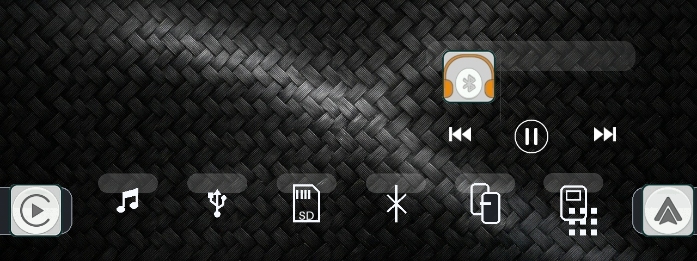

# 🚗 Allwinner F133 Boot Logo & Firmware Customizer (10.26" 1600×600)

<p align="center">
  <a href="README.md"><b>🇪🇸 Español</b></a> •
  <a href="README_EN.md">🇬🇧 English</a>
</p>

<p align="center">
  <a href="https://github.com/diegosagredo911"></a>
  <a href="https://github.com/diegosagredo911"></a>
  <a href="LICENSE"></a>
</p>

Herramienta automatizada en Python desarrollada por **Diego Sagredo Ailef** para personalizar y recompilar el firmware en pantallas multimedia portátiles para auto de **10.26 pulgadas (1600×600)** basadas en el procesador **Allwinner F133-B (RISC-V / Melis OS)**.

<p align="center">
  
</p>

<p align="center">
  <i>Dispositivo compatible: Pantalla portátil multimedia de 10.26" con Apple CarPlay, Android Auto y procesador Allwinner F133.</i>
</p>

---

## 📱 Dispositivo Compatible de Referencia

Esta herramienta está diseñada específicamente para las populares pantallas multimedia portátiles de salpicadero / espejo retrovisor:
* **Tamaño de pantalla:** 10.26 pulgadas IPS ultra-ancha (*ultrawide*).
* **Resolución física del panel:** **1600 × 600 píxeles** (relación de aspecto panorámica 8:3 / 24:9).
* **Procesador (SoC):** **Allwinner F133 / F133-B / D1s** (núcleo RISC-V 64-bit XuanTie C906, 64 MB DDR2).
* **Almacenamiento interno:** Memoria SPI NOR Flash de 16 MB.
* **Sistema operativo:** Melis 4.0 / RT-Thread con interfaz Orange/Lemon UI.
* **Modelos / Placas habituales:** `LSD-PND008`, `KA26S4618`, `UI82`, `PND-16M-board`.

---

## 🌟 Opciones que Puedes Personalizar

| Parámetro | Descripción | Cómo se configura |
| :--- | :--- | :--- |
| **🖼️ Logo de Arranque** | Imagen a pantalla completa (1600×600) de inicio. | Coloca tu archivo como `custom_logo.png` o `.jpg` |
| **🎨 Estilo de Interfaz** | Elige entre `stealth` (Luxe Titanio), `tactical` (Off-Road 4x4) o `cyber` (Neón Dinámico). | En `config.ini` o con `--theme stealth` |
| **🚗 Marca y Modelo** | Personaliza la insignia central con tu marca, modelo y edición (ej. `MITSUBISHI L200 KATANA`). | En `config.ini` (`[vehiculo]`) |
| **✨ Logo del Auto (Auto-BG)** | Coloca cualquier PNG/JPG de tu marca; Python remueve fondos negros/blancos automáticamente. | Carpeta `logos/` o con `--brand-logo` |
| **📶 Nombre Bluetooth** | Nombre que verás al vincular tu celular (ej. `L200`, `Hilux`, `MiAuto`, etc.). | En `config.ini` o con `--bt "Nombre"` |
| **🌐 Idioma por Defecto** | Idioma predeterminado al encender (Español, English, Francés, etc.). | En `config.ini` o con `--lang 3` |
| **🔊 Sonido de Encendido** | Silencio total (0dB) o tu propio sonido de campana/bienvenida. | En `config.ini` o colocando `custom_sound.wav` |
| **ℹ️ Información de Sistema** | Texto de versión mostrado en Ajustes -> Información del Sistema. | En `config.ini` o con `--version-text "Texto"` |

---

## 📸 Previsualizaciones

<p align="center">
  <b>1. Logo de Arranque a Pantalla Completa (1600×600)</b><br>
  
</p>

<p align="center">
  <b>2. Interfaz Principal Rediseñada (Tema Dark Titanium & Smoked Glass sobre Fibra de Carbono)</b><br>
  
</p>

---

## 📋 Requisitos

* **Python 3.7+** (Compatible con Windows, macOS y Linux).
* Librería **Pillow**:
  ```bash
  pip install -r requirements.txt
  ```

---

## 🚀 Guía de Uso Rápido (En 3 Pasos)

### Paso 1: Configura tus Preferencias
Tienes dos formas sencillas de configurar tus preferencias:

#### Método A: Editando el archivo `config.ini` (El más fácil)
Abre el archivo `config.ini` con cualquier editor de texto y personaliza a tu gusto:
```ini
[bluetooth]
# Nombre que mostrará la pantalla en tu celular (máximo 8 caracteres)
nombre = L200

[sistema]
# 3 = Español (Recomendado) | 2 = English | 4 = Ruso | 5 = Francés | 8 = Portugués
idioma = 3
version_texto = DIEGO SAGREDO EDITION 2026

[sonido]
# silencio = Encendido 100% silencioso sin pitidos (Recomendado)
# archivo  = Usa el archivo 'custom_sound.wav' que coloques en la carpeta
modo = silencio
archivo = custom_sound.wav
```

#### Método B: Colocando tus archivos en la carpeta
* **Tu imagen de logo:** Guárdala con el nombre `custom_logo.png` (o `custom_logo.jpg`).
* **Tu sonido personalizado (opcional):** Si deseas sonido de bienvenida, coloca un archivo de audio corto (1 a 4 segundos) con el nombre `custom_sound.wav` y pon `modo = archivo` en `config.ini`.

---

### Paso 2: Ejecuta el Script
Abre una terminal o consola en esta carpeta y ejecuta:

```bash
python3 cambiar_logo.py
```

*O si prefieres pasar opciones por terminal sin editar el `config.ini`:*
```bash
python3 cambiar_logo.py --bt "Hilux" --lang 3 --sound silencio
```

El script procesará todo en 2 segundos:
```text
===========================================================================
   🚗 F133 BOOT LOGO & FIRMWARE CUSTOMIZER (10.26" 1600x600)
   Desarrollado por: Diego Sagredo Ailef
   GitHub: https://github.com/diegosagredo911
===========================================================================

[1/5] Procesando imagen de arranque: custom_logo.png
      • Resolución de origen: 1600x600 px
      • Vista previa generada: output/vista_previa_pantalla.jpg
      • Rotación nativa MIPI DSI aplicada: (600, 1600) px
      • stalogo0.bin actualizado (83.9 KB)

[2/5] Configurando sonido de encendido...
      • Sonido de encendido configurado a 0dB digital (100% Silencioso).

[3/5] Aplicando configuraciones de sistema:
      • Nombre de Bluetooth: 'L200'
      • Idioma por defecto: Español (3)
      • Versión de sistema:  'DIEGO SAGREDO EDITION 2026'

[4/5] Re-empaquetando sistema de archivos MINFS (data_udisk.fex)...
      • 748 archivos empaquetados en MINFS.
      • Partición data_udisk completada: 12.69 MB

[5/5] Ensamblando imagen de firmware (IMAGEWTY container)...
      • Checksum sum32 recalculado: 0x8bcb272c
      • Firmware para USB: output/F133_IMG/melis_f133-b-pnd-16M-board_uart0_16Mnor.img
      • Firmware para MicroSD / PhoenixCard: output/melis_f133_custom.img

===========================================================================
   ✅ ¡FIRMWARE PERSONALIZADO GENERADO CON ÉXITO!
===========================================================================
```

---

### Paso 3: Instalar en la Pantalla

#### Actualización por Pendrive USB o MicroSD (Recomendado)
1. Toma una memoria USB de **32 GB o menos** y formatéala en formato **FAT32**.
2. Copia la carpeta **`output/F133_IMG`** completa directamente a la raíz de tu pendrive.
   * La estructura en el pendrive debe quedar así:
     ```text
     Pendrive USB (FAT32) /
        └── F133_IMG /
              └── melis_f133-b-pnd-16M-board_uart0_16Mnor.img
     ```
3. Conecta el pendrive a la pantalla mientras está encendida.
4. Si la pantalla no pregunta automáticamente:
   - Entra al menú de **Explorador de Archivos / USB**.
   - Entra en la carpeta `F133_IMG`, toca el archivo `.img` y presiona **Aceptar / OK**.
5. Espera a que la barra de progreso llegue al 100% y la pantalla se reiniciará sola con todas tus personalizaciones aplicadas.

---

## 📁 Estructura del Repositorio

```text
F133_BootLogo_Customizer/
├── README.md               <- Esta guía detallada
├── LICENSE                 <- Licencia MIT oficial de Diego Sagredo Ailef
├── cambiar_logo.py         <- Script principal automatizado
├── config.ini              <- Archivo de configuración (Bluetooth, idioma, sonido)
├── requirements.txt        <- Dependencias de Python (Pillow)
├── custom_logo.png         <- Imagen de logo de ejemplo
├── docs/
│   └── images/             <- Fotos del dispositivo y capturas para el README
│       ├── device_reference.webp
│       ├── bootlogo_preview.jpg
│       └── desktop_preview.png
├── assets/
│   ├── base_img/           <- Firmware base de 16MB (Allwinner LiveSuit container)
│   ├── extracted_fex/      <- Particiones de fábrica (.fex)
│   └── minfs_extracted/    <- Árbol del sistema de archivos MINFS 1.0
└── output/
    ├── vista_previa_pantalla.jpg   <- Previsualización generada a 1600x600
    └── F133_IMG/                   <- Carpeta lista para copiar al USB FAT32
        └── melis_f133-b-pnd-16M-board_uart0_16Mnor.img
```

---

## 🛠️ Personalizaciones Incluidas en el Firmware Base

La imagen base proporcionada en este repositorio incluye las siguientes mejoras automotrices:
1. **Tema Dark Titanium & Smoked Glass:** 27 iconos y widgets rediseñados en cristal ahumado oscuro con fino bisel titanio e iluminación táctil blanca (adiós al anticuado color turquesa/verde azulado de fábrica).
2. **Fondo de Fibra de Carbono:** Wallpaper de alta textura automotriz oscura precargado.
3. **Máxima Fluidez:** Animaciones lentas de widgets desactivadas (`widget_anim = 0`) para transiciones instantáneas.
4. **Crédito en Ajustes del Dispositivo:** Registrado en la pantalla de información del sistema (*Ajustes -> Info*):
   * `APP : F133PND701 - DIEGO SAGREDO EDITION`
   * `MOD : Diego Sagredo Ailef (@diegosagredo911)`

---

## 👤 Autor & Créditos

Proyecto desarrollado y mantenido por:
* **Diego Sagredo Ailef**
* **GitHub:** [@diegosagredo911](https://github.com/diegosagredo911)

---

## 📄 Licencia

Este proyecto está bajo la Licencia MIT. Consulta el archivo [LICENSE](LICENSE) para más detalles.
