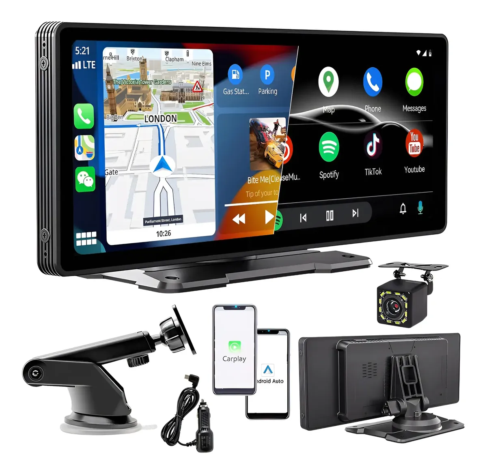
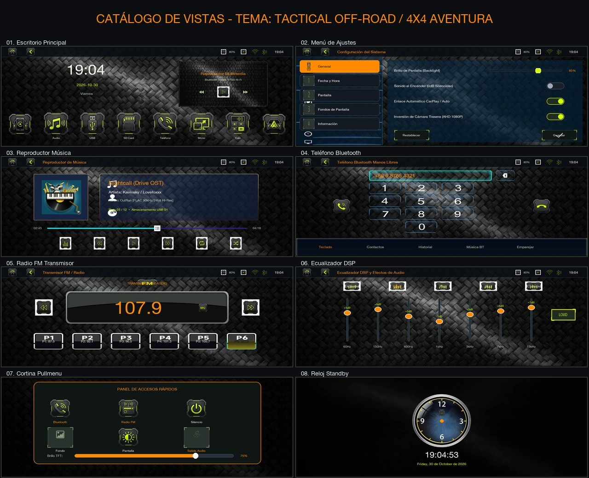
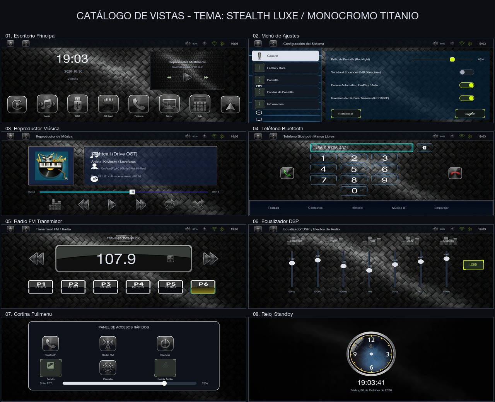
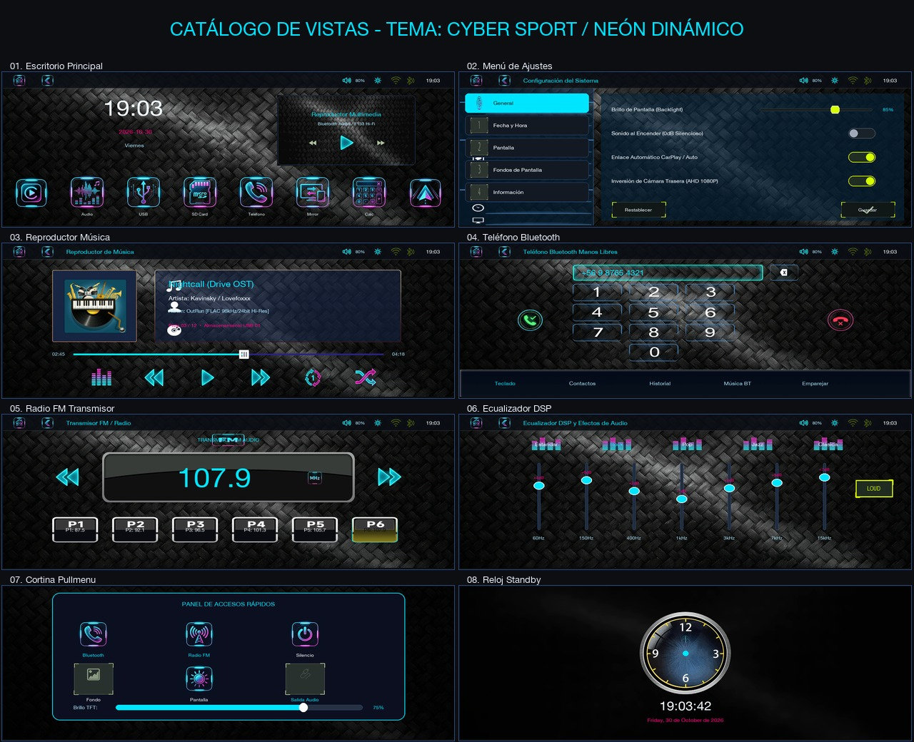

# 🚗 Allwinner F133 Boot Logo & Firmware Customizer (10.26" 1600×600)

<p align="center">
  <a href="README.md">🇪🇸 Español</a> •
  <a href="README_EN.md"><b>🇬🇧 English</b></a>
</p>

<p align="center">
  <a href="https://github.com/diegosagredo911"></a>
  <a href="https://github.com/diegosagredo911"></a>
  <a href="LICENSE"></a>
  
</p>

An automated, cross-platform Python tool created by **Diego Sagredo Ailef** to customize, resize, and repack the firmware for **10.26-inch (1600×600) portable car multimedia screens** powered by the **Allwinner F133 / F133-B / D1s (RISC-V 64-bit / Melis OS)** SoC.

<p align="center">
  
</p>

<p align="center">
  <i>Compatible Device: 10.26" Portable Dashboard CarPlay / Android Auto Display (Allwinner F133).</i>
</p>

---

## 📱 Compatible Hardware & Commercial Models

This tool is designed for the widely popular 10.26-inch dashboard / rearview mirror displays sold worldwide on Amazon, AliExpress, and eBay under various automotive brands:

* **Commercial Brands & Rebrands:** Carpuride, Podofo, Imagebon, Lamto, Coral Vision, Spedal, Jansite, Hikity, Pelsee, and generic Android Auto / CarPlay dashboard screens.
* **Motherboard & Firmware Codes:** `LSD-PND008`, `KA26S4618`, `UI82`, `PND-16M-board`.
* **SoC Processor:** **Allwinner F133 / F133-B / D1s** (64-bit RISC-V XuanTie C906 core @ 1.0 GHz, 64 MB integrated DDR2).
* **Display Resolution:** **1600 × 600 pixels** ultrawide IPS panel (native physical MIPI DSI 600×1600).
* **Storage:** 16 MB SPI NOR Flash memory running **Melis 4.0 / RT-Thread** with MINFS 1.0 filesystem.

---

## 🌟 What You Can Customize

| Feature | Description | How to Configure |
| :--- | :--- | :--- |
| **🖼️ Fullscreen Boot Logo** | Native edge-to-edge 1600×600 boot splash image without black borders. | Place `custom_logo.png` or `custom_logo.jpg` |
| **🎨 UI Theme Style** | Choose between `tactical` (Off-Road 4x4), `stealth` (Titanium Luxe), `cyber` (Dynamic Neon) or `original` (Stock Factory). | In `config.ini` (`estilo = ...`) or `--theme <tactical\|stealth\|cyber\|original>` |
| **🚗 Vehicle Brand & Model** | Customize the central dashboard badge with your car brand, model and edition. | In `config.ini` (`[vehiculo]`) |
| **✨ Smart Logo (Auto-BG Removal)** | Put any brand PNG/JPG; Python automatically removes black/white backgrounds. | `logos/` folder or `--brand-logo` |
| **📶 Bluetooth Device Name** | Custom name displayed when pairing with phones (e.g. `L200`, `Hilux`, `MyCar`). | In `config.ini` or `--bt "Name"` |
| **🌐 Default Language** | Startup default language (English, Spanish, French, German, etc.). | In `config.ini` or `--lang 2` |
| **🔊 Startup Audio** | Digital 0dB pure silence (no annoying startup beep) or your own custom audio chime. | In `config.ini` or place `custom_sound.wav` |
| **ℹ️ System Info String** | Custom version string in Settings -> System Info. | In `config.ini` or `--version-text "Text"` |

---

## 🎨 Visual Themes & UI View Catalog

The system includes **3 complete visual themes** crafted with **Gemini AI** and optimized in Python using 8-bit P-PNG palette and native tRNS alpha, as well as the ability to **revert to the untouched factory firmware graphics at any time**:

### 1. Tactical Off-Road / 4x4 Adventure (`--theme tactical`)
> Rugged 4x4 adventure style inspired by Dakar rally instrumentation. High-contrast amber/orange accents, 45° chamfered bezels, and bold navigation glyphs.
<p align="center">
  
</p>

### 2. Stealth Luxe / Monochrome Titanium (`--theme stealth`)
> High-end executive aesthetic featuring a brushed titanium monochrome palette, translucent smoked glass surfaces, and minimalist clean icons.
<p align="center">
  
</p>

### 3. Cyber Sport / Dynamic Neon (`--theme cyber`)
> Futuristic sports cockpit styling with vibrant electric cyan and magenta neon glowing accents, optimized for night drive legibility.
<p align="center">
  
</p>

### 🔄 How to Switch Themes or Restore Stock Factory Graphics

You can switch between any theme or return to the clean stock factory firmware with a single command:

```bash
# Apply Tactical Theme (Off-Road 4x4)
python3 cambiar_logo.py --theme tactical

# Apply Stealth Theme (Titanium Luxe)
python3 cambiar_logo.py --theme stealth

# Apply Cyber Theme (Neon Sport)
python3 cambiar_logo.py --theme cyber

# Restore Untouched Factory Stock Theme
python3 cambiar_logo.py --theme original
```

*Or set it permanently in `config.ini`:*
```ini
[interfaz]
# Options: tactical | stealth | cyber | original
estilo = tactical
```

---

### 📱 Views Included in Each Theme (1280×480)

Each theme directory (`themes/<name>/vistas/`) contains high-definition captures of all 8 OS views:

1. **`01_escritorio.png`**: Main Desktop with clean carbon fiber background, CarPlay & Android Auto widgets, live clock/date, media card, and 6 app launcher tiles.
2. **`02_ajustes.png`**: Settings menu with translucent sidebar `setting/tab_bg.png`, category tabs, themed ON/OFF switches, sliders, and action buttons.
3. **`03_musica.png`**: Hi-Res music player with vinyl disc art, track metadata panel, seek bar, and playback controls (`eq`, `prev`, `play`, `next`, `repeat`, `random`).
4. **`04_telefono_bluetooth.png`**: Hands-free dialer with dial display, numeric keypad, call/hangup buttons, and translucent bottom tab bar `bt/tab_bg.png`.
5. **`05_radio_fm.png`**: FM transmitter & tuner with large digital frequency display (e.g., 107.9 MHz), tuning arrows, and 6 quick presets (P1 to P6).
6. **`06_ecualizador.png`**: DSP graphic equalizer with 7 frequency sliders (+/- dB), custom fader knobs, genre presets, and Loudness toggle.
7. **`07_cortina_pullmenu.png`**: Quick swipe-down drawer with 6 floating modules (BT, FM, Mute, Wallpaper, TFT, AOut) and backlight slider.
8. **`08_reloj_standby.png`**: Lock/standby clock with themed analog watchface, independent hands (hour, minute, second), and synchronized digital clock.

---

## 📸 Previews

<p align="center">
  <b>1. Fullscreen Native 1600×600 Boot Logo</b><br>
  
</p>

---

## 📋 Requirements

* **Python 3.7+** (Compatible with Windows, macOS, and Linux).
* **Pillow** library:
  ```bash
  pip install -r requirements.txt
  ```

---

## 🚀 Quick Start Guide (3 Simple Steps)

### Step 1: Set Your Preferences
You have two simple options:

#### Option A: Edit `config.ini` (Easiest)
Open `config.ini` in any text editor and adjust your preferences:
```ini
[bluetooth]
# Bluetooth name shown on your smartphone (max 8 chars for memory register)
nombre = MyCar

[sistema]
# 2 = English | 3 = Spanish | 4 = Russian | 5 = French | 6 = German | 8 = Portuguese
idioma = 2
version_texto = MY CAR EDITION 2026

[sonido]
# silencio = 100% digital 0dB silent boot without beeps (Recommended)
# archivo  = Play your own 'custom_sound.wav' chime file
modo = silencio
archivo = custom_sound.wav
```

#### Option B: Put Your Files in the Folder
* **Boot Logo Image:** Save your desired image as `custom_logo.png` (or `custom_logo.jpg`).
  > **Tip:** Recommended resolution is **1600 × 600** (8:3 ratio). If you provide a 16:9 or 4:3 image, the tool automatically scales it and centers it on a seamless black canvas without distortion.
* **Custom Chime Sound (Optional):** If you want a custom boot sound, place an audio file named `custom_sound.wav` and set `modo = archivo` in `config.ini`. The built-in converter automatically resamples it to 44.1kHz 16-bit stereo PCM.

---

### Step 2: Run the Script
Open your terminal in this directory and run:

```bash
python3 cambiar_logo.py
```

*Or pass arguments directly from the command line:*
```bash
python3 cambiar_logo.py --bt "MyCar" --lang 2 --sound silencio
```

The script runs in under 2 seconds:
```text
===========================================================================
   🚗 F133 BOOT LOGO & FIRMWARE CUSTOMIZER (10.26" 1600x600)
   Desarrollado por: Diego Sagredo Ailef
   GitHub: https://github.com/diegosagredo911
===========================================================================

[1/5] Procesando imagen de arranque: custom_logo.png
      • Resolución de origen: 1600x600 px
      • Vista previa generada: output/vista_previa_pantalla.jpg
      • Rotación nativa MIPI DSI aplicada: (600, 1600) px
      • stalogo0.bin actualizado (83.9 KB)

[2/5] Configurando sonido de encendido...
      • Sonido de encendido configurado a 0dB digital (100% Silencioso).

[3/5] Aplicando configuraciones de sistema:
      • Nombre de Bluetooth: 'MyCar'
      • Idioma por defecto: English (2)
      • Versión de sistema:  'MY CAR EDITION 2026'

[4/5] Re-empaquetando sistema de archivos MINFS (data_udisk.fex)...
      • 748 archivos empaquetados en MINFS.
      • Partición data_udisk completada: 12.69 MB

[5/5] Ensamblando imagen de firmware (IMAGEWTY container)...
      • Checksum sum32 recalculado: 0x8bcb272c
      • Firmware para USB: output/F133_IMG/melis_f133-b-pnd-16M-board_uart0_16Mnor.img
      • Firmware para MicroSD / PhoenixCard: output/melis_f133_custom.img

===========================================================================
   ✅ ¡FIRMWARE PERSONALIZADO GENERADO CON ÉXITO!
===========================================================================
```

---

### Step 3: Install on Your Screen

#### Method 1: USB Flash Drive or MicroSD (Recommended)
1. Take a USB flash drive (or MicroSD with adapter) of **32 GB or smaller** and format it to **FAT32**.
2. Copy the entire **`output/F133_IMG`** folder directly to the root of your USB drive.
   * The structure on the USB drive must be:
     ```text
     USB Drive (FAT32) /
        └── F133_IMG /
              └── melis_f133-b-pnd-16M-board_uart0_16Mnor.img
     ```
3. Plug the USB drive into the screen while it is powered on.
4. If the screen does not prompt automatically:
   - Open **File Explorer / USB** in the screen menu.
   - Enter the `F133_IMG` folder, tap the `.img` file, and confirm (**OK / Update**).
5. Wait for the progress bar to reach 100%. The screen will reboot automatically with your new fullscreen boot logo, dark titanium theme, and custom Bluetooth name.

#### Method 2: Hardware Flashing via PhoenixCard (MicroSD)
1. Insert a MicroSD card into your PC.
2. Open **PhoenixCard** (official Allwinner utility).
3. Select your MicroSD drive, load `output/melis_f133_custom.img`.
4. Choose **Product** mode and click **Burn**.
5. Insert the card into the powered-off display and power it on to trigger the hardware bootloader flash.

---

## 📁 Repository Structure

```text
F133_BootLogo_Customizer/
├── README.md               <- Spanish documentation (with language switcher)
├── README_EN.md            <- English documentation (this file)
├── LICENSE                 <- Official MIT License
├── cambiar_logo.py         <- Main Python automation tool
├── config.ini              <- Configuration file (Bluetooth, language, sound)
├── requirements.txt        <- Python dependencies (Pillow)
├── custom_logo.png         <- Default sample logo image
├── docs/
│   └── images/             <- Device reference photo and preview screenshots
│       ├── device_reference.webp
│       ├── bootlogo_preview.jpg
│       └── desktop_preview.png
├── assets/
│   ├── base_img/           <- Base 16MB image (Allwinner LiveSuit container)
│   ├── extracted_fex/      <- Factory partition components (.fex)
│   └── minfs_extracted/    <- Unpacked MINFS 1.0 root filesystem
└── output/
    ├── vista_previa_pantalla.jpg   <- Real-time 1600x600 display preview
    └── F133_IMG/                   <- Pre-formatted folder ready to copy to FAT32 USB
        └── melis_f133-b-pnd-16M-board_uart0_16Mnor.img
```

---

## 🛠️ Enhancements Included in the Base Firmware

1. **Global Theme Suite Powered by Gemini AI (`stealth`, `tactical`, `cyber`):** Comprehensive visual styling across **all system screens and views**:
   * **110+ HD Icons per Theme:** Generated with Gemini AI via dual master sheets (*Primary App Sheet* + *Media & Explorer Sheet*) and processed with Python.
   * **Main Desktop:** CarPlay, Android Auto, Phone, Music, Calculator, USB, SD, Mirrors, and styled `desktop_bg.png` media card.
   * **Full Music Player (`music/`):** High-res Play, Pause, Prev, Next, Repeat/Loop, Shuffle, Queue, and Equalizer controls.
   * **USB File Explorer (`explorer/`):** Custom icons for Folders, Audio, Video, and Image files.
   * **Top Headbar & Popups:** Themed Home, Back, Aux buttons, and floating volume/brightness overlay controls.
   * **Settings & Quick Pull-down Menu:** Category tabs, modern pill-style ON/OFF switches, sliders, and quick toggles.
   * **Equalizer (EQ):** Sound presets, Loudness toggle, and balance controls.
2. **Carbon Fiber Wallpaper:** High-res dark automotive carbon fiber texture preloaded.
3. **Optimized Responsiveness:** Unnecessary widget animations disabled (`widget_anim = 0`) for instant, lag-free transitions.
4. **Credit in Settings:** System Info screen (*Settings -> Info*) shows:
   * `APP : F133PND701 - DIEGO SAGREDO EDITION`
   * `MOD : Diego Sagredo Ailef (@diegosagredo911)`

---

## 👤 Author & Credits

Project created and maintained by:
* **Diego Sagredo Ailef**
* **GitHub:** [@diegosagredo911](https://github.com/diegosagredo911)

---

## 📄 License

This project is licensed under the MIT License - see the [LICENSE](LICENSE) file for details.
